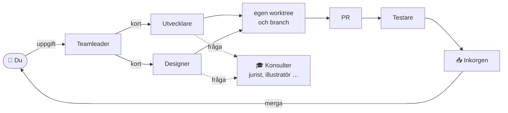

<p align="center">
  
</p>

<h1 align="center">Kontrollrummet</h1>

<p align="center">
  <b>Ett agentteam av Claude Code-agenter för dina repon, på din egen dator.</b>
</p>

<p align="center">
  
  
  
  
  <a href="LICENSE"></a>
</p>

<p align="center">
  <a href="#kom-igång">Kom igång</a> ·
  <a href="#anpassa">Anpassa</a> ·
  <a href="#så-fungerar-det">Så fungerar det</a> ·
  <a href="#säkerhet">Säkerhet</a> ·
  <a href="SETUP.md">SETUP.md</a>
</p>

---

Varje team arbetar i ett repo, och alla i teamet är vanliga Claude Code-sessioner:

<table align="center">
  <tr>
    <td align="center"><br><sub><b>Teamleader</b></sub></td>
    <td align="center"><br><sub><b>Arkitekt</b></sub></td>
    <td align="center"><br><sub><b>Bug-agent</b></sub></td>
    <td align="center"><br><sub><b>Designer</b></sub></td>
    <td align="center"><br><sub><b>iOS</b></sub></td>
    <td align="center"><br><sub><b>Webb</b></sub></td>
    <td align="center"><br><sub><b>Testare</b></sub></td>
  </tr>
</table>

Du är projektledare. Du lämnar uppgifter, teamleadern delar ut dem, och varje kort arbetas i en egen git-worktree och slutar i en PR. Allt syns på en board, där du kan följa varje uppgift, svara när en agent undrar något och godkänna det som kräver lov.



> [!TIP]
> Det kräver ingen API-nyckel till Claude. Agenterna använder din vanliga Claude Code-inloggning och prenumeration, och allt körs på datorn där repona, verktygen och nycklarna finns, på Macen även Xcode, signeringen och simulatorerna.

## Vad som ingår

| | | |
|---|---|---|
| 🏢 | **Kontoret** | Boarden och medarbetarna på samma sida. En agents inställningar (modell, instruktioner med mera) öppnas med ett klick. Med **Kontoret 3D** syns teamet som ett kontor i 3D, där varje agent gör det dess kort säger. |
| 📐 | **Planer** | Arkitektens planer, som du genomför, parkerar eller kastar. |
| 🚀 | **Releases** | Vilken version av varje app som ligger i test, är på väg och är ute i App Store, Google Play och Microsoft Store, med knappar för testbuild och prod. |
| 🎩 | **Gudfadern** | Din egen Claude utan team, i valfri mapp och på valfritt konto. Här bygger du vidare på kontrollrummet, och den ersätter Claude Code-appen. |
| 🎓 | **Konsulter** | Specialister som agenterna frågar över API i stället för kollegor på kontoret: en jurist på en modell som är bra på juridik, en illustratör som ritar, en översättare, en säkerhetstestare. De bygger på andra modeller än Claude (OpenAI, Gemini, Grok, Perplexity med flera) och svarar på en fråga i taget, och agenten gör jobbet med svaret. Du väljer vem som får fråga och när du vill ge ditt samtycke. |
| 📥 | **Inkorgen** | Det som väntar på dig: beslut, godkännanden, PR:er att merga och PR:er att granska. En PR som du ombetts granska kan du ge till teamleadern med ett klick. |
| ☁️ | **Infrastruktur och loggning** | Var varje projekt körs (moln, konton, resurser) och var felen läses, identifierat av en agent och redigerbart. |
| 💻 | **En egen app** | Kontrollrummet.app på Macen och Kontrollrummet.exe på Windows, med systemnotiser när något är klart eller behöver dig. |
| 📱 | **Skrivborden** | Nås från Claude-appen i telefonen via Remote Control. |

---

## Kom igång

### Låt din Claude sätta upp det

Klistra in det här i Claude Code (i en terminal, på datorn där Kontrollrummet ska köras):

```
Sätt upp Kontrollrummet åt mig: klona https://github.com/KaffaKaffa/kontrollrummet och följ SETUP.md i repot, steg för steg. Fråga mig bara det du inte kan ta reda på själv.
```

Claude kontrollerar och installerar det som saknas, installerar Kontrollrummet med app och autostart, och skapar ditt första projekt från ett repo du pekar ut. Det du behöver göra själv är att logga in där ett terminalfönster ber om det. [`SETUP.md`](SETUP.md) visar exakt vad som händer.

### Det här behöver du
- **macOS** med Xcode Command Line Tools (för `swiftc` och `git`), eller **Windows 10/11** med Git.
- Node 22.18 eller nyare. Servern använder `node:sqlite` och kör TypeScript direkt.
- Claude Code (`claude`), inloggat med en prenumeration.
- `gh`, inloggat mot GitHub, eller `az` för Azure DevOps. Agenterna pushar och öppnar PR:er med dem.
- Valfritt:
  - API-nycklar till OpenAI (porträtt, loggor, konsulter) och Google Gemini (konsulter). Läggs in under Inställningar → Konsulter → API-nycklar: knappen öppnar sidan där nyckeln skapas och ett terminalfönster där du klistrar in den
  - GitHub Copilot som konsultleverantör (modeller från flera leverantörer via din licens): en fine-grained token med behörigheten "Copilot Requests" (inte en klassisk `ghp_`) under Inställningar → Konsulter → API-nycklar, sparad i nyckelringen eller krypterad på Windows. Copilot CLI följer med som ett låst beroende och uppdaterar sig inte. Utan token är leverantören avstängd. Gäller licensen en organisation: kolla först med den som ansvarar för den vilka modeller och vilken kod som får gå till GitHub och vidare till leverantörerna
  - App Store Connect-, Play- och Partner Center-nycklar för Releases
  - Parallels för Windows-tester från en Mac

<details>
<summary><b>Installera för hand</b></summary>

```
git clone https://github.com/KaffaKaffa/kontrollrummet.git ~/Dev/kontrollrummet
cd ~/Dev/kontrollrummet
npm install
```

1. **Om du kör Claude Code med en annan profil än standard**, skapa `~/.control-room/env`. Profilen blir standardkontot (se Konton nedan):
   ```
   export CLAUDE_CONFIG_DIR="$HOME/.claude-annan-profil"
   export GH_CONFIG_DIR="$HOME/.claude-annan-profil/gh"
   ```
   På Windows skrivs samma sak utan `export`: `NAMN=värde` per rad. Agenterna, skrivborden och knappen Terminal ärver profilen. Använder du standardprofilen behövs ingen fil. `CONTROL_ROOM_OWNER=<förnamn>` sätter vad agenterna kallar dig, om `gh` inte vet det.
2. **Prova:**
   ```
   npm start            # bygger webben och startar på http://127.0.0.1:4317
   ```
3. **Installera på riktigt**, så att servern startar vid inloggning och appen finns:
   ```
   OPENAI_API_KEY=sk-… npm run install:mac      # macOS; nyckeln är valfri och sparas i nyckelringen
   ```
   ```
   $env:OPENAI_API_KEY = 'sk-…'                  # Windows (PowerShell); valfri, sparas krypterad (DPAPI)
   npm run install:windows
   ```
4. **Skrivborden:** öppna `claude remote-control` en gång i `desks/teamleader`, `desks/architect` och `desks/gudfadern`, och svara ja på frågorna om att lita på mappen och slå på Remote Control. Avsluta med Ctrl+C. Skrivborden startar sedan av sig själva.
5. **Första projektet** skapar du i appen med **+** i toppraden. Projekten checkas aldrig in, se [`teams/README.md`](teams/README.md).

**macOS:** `install:mac` bygger Kontrollrummet.app i `~/Applications` och en enda LaunchAgent, `se.kontrollrummet`: appens egen programfil i bakgrundsläge (`Kontrollrummet --supervise`) kör servern och skrivborden från `~/.control-room/services.json`. Under Inloggningsobjekt och Integritet och säkerhet heter den därför Kontrollrummet, inte node. `npm run uninstall:mac` tar bort det.

**Windows:** `install:windows` bygger `Kontrollrummet.exe` med ikonen (med C#-kompilatorn som finns i Windows) i `%LOCALAPPDATA%\Kontrollrummet`, och lägger den i Autostart (`--supervise`: servern och skrivborden, en post "Kontrollrummet" i Aktivitetshanteraren), i Start-menyn och på skrivbordet. Där öppnar den tavlan i ett eget appfönster i Edge eller Chrome. Inloggningar öppnas i Windows Terminal, och tokens sparas krypterade i `~/.control-room/secrets`. `npm run uninstall:windows` tar bort det.

</details>

> [!NOTE]
> Data, loggar och inställningar finns kvar i `~/.control-room` efter en avinstallation.

---

## Anpassa

Allt som går att anpassa ligger i textfiler. Team och roller läses om vid varje anrop, så ändringar gäller från agentens nästa tur utan omstart. Ändrar du serverkoden behöver servern startas om: menyn i appen → Starta om servern.

### Konton

Ett Claude-konto är en Claude Code-profil: en mapp med egen inloggning, prenumeration, MCP-servrar och skills. `~/.claude` är standardprofilen, och andra profiler är mappar som `~/.claude-privat`, som Claude Code använder med `CLAUDE_CONFIG_DIR`.

- Första gången servern startar hittar den alla `~/.claude*`-profiler och skriver dem till `~/.control-room/accounts.json`: `{ "default": "<id>", "accounts": [{ "id", "name", "claudeConfigDir", "ghConfigDir"? }] }`. Där kan du byta namn eller lägga till fler.
- Ett team väljer konto med `"account": "<id>"` i `team.local.json`. Utan det används standardkontot.
- Agenterna, "Öppna i terminal" och `gh` körs som teamets konto. Har profilen en `gh`-mapp används den.
- Varje konto är en egen prenumeration, så **gränsen för samtidiga agenter och kvotstoppet gäller per konto**. Topbaren visar fönstren för det konto som valt team eller samtal använder.
- Ett konto som inte är inloggat loggas in från Gudfadern eller projektets kontroller, som öppnar ett terminalfönster med `claude /login` och rätt profil. Är kontot utloggat när ett kort startar, stannar kortet på Behöver dig med en knapp för att logga in och fortsätta.

### Nytt projekt

`+` bredvid teamen öppnar guiden. Den frågar efter det som behövs och fyller i förslag:
1. **Repot:** en mapp på datorn, en URL att klona, eller ett nytt repo på GitHub eller i Azure DevOps. En mapp läses in direkt (`server/scan.ts`): git-värd och basbranch från origin, vilka appar som finns (webb, backend, iOS, Android, Mac, Windows, infra), och om det redan har `CLAUDE.md`, skills och `.mcp.json`. Ett repo som ska klonas eller skapas får förslag utifrån det du kryssar i att det ska innehålla.
2. **Namn och Claude-konto.**
3. **Agenter** från mallarna i `library/roles/`, med föreslagna förkryssade och ägda mappar ifyllda. Ett litet repo får en utvecklare i stället för en per app.
4. **Skills och instruktioner.** Det projektet redan har listas först, märkt *Finns* och ikryssat: instruktionsfiler som `CLAUDE.md` och `CLAUDE.local.md`, skills och kommandon (`.claude/commands`), i mappen och i varje repo. Instruktionsfilerna läses alltid av Claude Code. En skill eller ett kommando som kryssas ur stängs av för projektets agenter (`"disabledSkills"` i `team.json`, `Skill(<namn>)` i agenternas spärrlista). Nya skills från `library/skills/` är märkta *Ny* och läggs till *lokalt* (kopieras till `.claude/skills/` och hålls utanför git med `.git/info/exclude`) eller *checkas in* (läggs in i en PR). Här skrivs också teamets regler (`shared.md`).
5. **MCP-servrar** enligt mallarna, till exempel Figma för designern och Playwright för testaren.
6. **Logga:** ladda upp, eller beskriv den så ritas den med OpenAI.
7. **Kontroller** (se nedan). För ett befintligt repo måste allt som krävs vara grönt.

När projektet är skapat identifierar en agent själv var det körs, under Infrastruktur (se nedan).

Ett första **onboarding-kort** låter teamet läsa in sig: det skriver `CLAUDE.md` om den saknas, checkar in valda skills och sparar anteckningar per roll, i en PR. Gudfadern och skrivborden kan göra samma sak med verktygen `scan_repo` och `create_project`.

### Flera repon i ett projekt

Ett projekt kan vara en mapp med flera repon som hör ihop, som `~/Dev/Kund` med Admin, Store och Web. Välj mappen i guiden, så listas repona under den:
- **Extra kloner** av samma remote, som `Web-feature-123`, är urkryssade som förval.
- **Teamleadern, arkitekten och bug** arbetar i mappen och ser alla repon och mappens `CLAUDE.md`.
- **Agenterna** har `repo:` i sin roll, till exempel `repo: Web, Admin`. Det första repot är agentens eget, och korten får worktree och PR där. Ett kort kan gälla ett annat repo med `repo` i `create_subtask` eller `delegate`. Testkort följer det repo PR:en gjordes i.
- **Skills som bara finns här** läggs i mappens `.claude/skills/` och länkas in i varje worktree, utanför git.
- **`team.local.json`** får `"repos": { "Web": "Web", … }` (sökvägar relativt mappen) och `"baseBranches"`. Basbranchen föreslås per repo: `develop` när den finns (GitFlow), annars `origin/HEAD`. Den går att ändra i guiden.

**Azure DevOps i en annan tenant.** `az` har en aktiv inloggning per profil. Varje projekt bör ha en egen profil, så att en inloggning i ett projekt aldrig byter konto i ett annat: Inställningar → Git → Azure DevOps, eller `"azureConfigDir": "~/.azure-<projekt>"` i `team.local.json`. Agenterna, PR-bevakningen och kontrollerna använder sedan den profilen.

### Projektinställningar

Fliken Inställningar på varje team har fyra flikar:
- **Projektet:** namn, basbranch, Claude-konto och logga (`teams/<id>/logo.png|svg|jpg|webp`), människorna i projektet, agenterna (lägg till från mallarna eller ta bort; borttagna hamnar i `roles/.removed/`), skills och MCP-servrar.
- **Git:** kontrollerna (Claude-kontot är inloggat, repot och `origin/<basbranch>` finns, `gh` eller `az` har skrivrätt, verktygen stacken kräver finns, agenternas MCP-servrar ansluter) och projektets egen az-profil för Azure DevOps. Varje fel har en knapp: ett terminalfönster öppnas med rätt kommando och konto, eller så rättas det direkt. "Kontrollera MCP" startar servrarna en gång och kostar ett kort Haiku-svar.
- **Infrastruktur:** var projektet körs, som en lista: molnprojekt, konton, resurser, databaser. **Identifiera** låter en agent läsa infrastruktur som kod (bicep, terraform, `firebase.json`, wrangler, `eas.json`, CI), repot, projektets Claude-minne och vad de inloggade CLI:erna säger, och lägga till det som saknas. Skriver du i rutan gör den det du skriver i stället, till exempel "portalens resurser når vi med adm-kontot". Varje post visar sina uppgifter och om inloggningen fungerar, och har knappar för att logga in, redigera och ta bort. Agenterna får listan i sin prompt, med kontot och projektet uttryckligen (miljövariabler som `CLOUDSDK_CORE_PROJECT`, flaggor som `--subscription`), så att inget kommando hamnar på ett verktygs standardkonto. Saknar en agent något föreslår den det med `suggest_infra`, och du godkänner eller avvisar. Listan sparas i `team.local.json` (`"infraItems"`).
- **Loggning:** de poster som är felkällor (Sentry, Application Insights, Google Cloud Logging), hur ofta de läses, och **Testa**.

### MCP per agent

`mcp:` i en roll väljer exakt vilka servrar agenten får: `mcp: figma, playwright`. Agenten startar alltid med `--strict-mcp-config` och bara de servrarna, så den läser inga andra servrars instruktioner. `mcp: all` (eller `true`) ger kontots alla servrar och claude.ai-connectors, vilket kostar mest. Utan `mcp:` finns bara kontrollrummets verktyg.

Servrarna kan komma från fem ställen, och den mest specifika vinner:
- kontrollrummets bibliotek (`library/mcp.json`),
- kontots egna,
- kontots för just det repot,
- repots `.mcp.json`,
- `"mcp"` i `team.json`.

OAuth-inloggningar sparas i kontots profil, så en server som Figma ansluter som den redan är inloggad. Hemligheter som en server anger som `${VAR}` läses från nyckelringen vid start: `"secrets": { "VAR": "<nyckelringspost>" }` i `team.local.json`.

### GitHub och Azure DevOps

Git-värden läses från `origin`. PR-bevakningen, Figma-synken och agenternas PR-instruktioner går via `server/git.ts`: `gh` för GitHub och `az repos` för Azure DevOps (kräver tillägget `azure-devops`). Båda körs som teamets konto. Ett konto kan ha egen `az`-konfiguration med `azureConfigDir` i `accounts.json`. Handoff mellan kontrollrum fungerar bara på GitHub.

### Gudfadern

Fliken Gudfadern är en Claude utan team, kort eller roll. Varje samtal har:
- **Mapp:** hemmappen, kontrollrummet, ett av teamens repon eller valfri mapp. Ett git-repo kan få en egen worktree och branch, `gudfadern/gf-<id>-…`, och det är förvalt för kontrollrummet.
- **Konto, modell, tankenivå och MCP**, som går att ändra mellan turerna. Byter du konto börjar nästa tur en ny session som får med sig det senaste i samtalet, eftersom en session hör till en profil.
- **Samma snålhet som korten:** sammanfattning vid 140k, kapade utskrifter, och bara kontrollrummets MCP om du inte väljer "Kontots alla".
- **Skrivbordets verktyg:** Gudfadern kan lämna uppgifter till team, följa kort och svara på dem. Det auto-läget skulle fråga om visas i samtalet för godkännande.
- **Ta i bruk:** mergar samtalets branch in i repot det kom från. För kontrollrummet startar servern sedan om, först när inga agenter arbetar, och bygger om webben.
- **Ny session, Terminal, Bifoga och Arkivera.** Bilder och filer klistras in, dras hit eller bifogas, som i korten. De sparas i `~/.control-room/uploads/`, och sökvägen skickas med meddelandet.

Ett meddelande du skriver medan Gudfadern arbetar blir nästa tur. Samtal räknas in i kontots gräns, men köar aldrig, eftersom du själv har bett om dem.

### Team

Ett team är en mapp under `teams/`. Projekten är din dators egna och checkas aldrig in; [`teams/team.local.example.json`](teams/team.local.example.json) visar formen på den lokala filen.

```
teams/<id>/
  team.json                 delas i repot: appar, butiker, Figma-synk
  team.local.json           bara din dator: sökvägar, konto, infrastruktur, VM:ar
  shared.md                 regler som gäller teamets alla roller
  roles/*.md                en fil per agent
```

`team.local.json` läggs ovanpå `team.json`. Objekt slås ihop nyckel för nyckel, och för allt annat vinner den lokala filen.

<details>
<summary><b>Alla fält i team.json och team.local.json</b></summary>

| Fält | Var | Vad |
|---|---|---|
| `name` | team.json | Namnet i topbaren |
| `repo` | local | Checkouten teamet arbetar i. Worktrees hamnar i `<repo>/.claude/worktrees/`. |
| `account` | local | Claude-kontot agenterna kör på, se Konton |
| `repos` | local | Flera repon under `repo`: `{ "<id>": "<sökväg>" }` |
| `azureConfigDir` | local | Projektets egen `az`-profil för Azure DevOps |
| `mcp` | team.json | Teamets egna MCP-servrar, `{ "<id>": <config> }` |
| `secrets` | local | Miljövariabler till MCP-servrar, ur nyckelringen |
| `baseBranch` | team.json | Branchen kort utgår från och PR:er går till (`main`) |
| `memory` | local | Projektets Claude Code-memory (`MEMORY.md`). En worktree hittar den inte själv, så den pekas ut i prompten. |
| `owner` | local | Vad agenterna kallar dig, den som kör kontrollrummet. Utelämnat: `handoff.name`, sedan förnamnet på GitHub-kontot som `gh` är inloggat på, sedan inloggningsnamnet. Läses en gång när servern startar. I `shared.md` och rollerna står `{{owner}}` (och genitiv `{{owners}}`) där namnet hamnar. |
| `figmaSync` | team.json | Sökvägar där mergade ändringar ger designern ett "synka Figma"-kort |
| `releases.apps` | team.json | Store-apparna, se Releases nedan |
| `releases.appStoreConnect`, `releases.play` | local | Var nycklarna finns |
| `vms` | local | Virtuella maskiner som agenterna får be om att starta |

</details>

Ett nytt team skapas enklast med guiden (`+` i topbaren), men det är bara en ny mapp och går lika bra att skriva för hand. Topbaren visar teamen med logga och antal kort som väntar på dig.

### Roller

En roll är en fil i `teams/<id>/roles/`:

```
---
name: Backend
kind: app                 # lead | architect | bug | tester | designer | app
vibe: Hoodie och tre skärmar. Rollens stereotyp, till porträttet och kontoret.
look: Man i 30-årsåldern, lockigt hår, rutig skjorta   # valfri: utseendet, till porträtt och 3D-gubbe
character: backend        # valfri: vilken 3D-gubbe rollen använder (standard: mallen med samma id)
title: En rad om vad agenten gör
model: opus               # opus | sonnet | haiku | ett fullt modellnamn
wakeModel: sonnet         # valfri: billigare modell för uppföljningsturer
context: 140000           # valfri: hur stort samtalet får bli innan det sammanfattas
effort: medium            # valfri: tankenivå (low | medium | high | xhigh); väckningar kör alltid low
mcp: figma, playwright    # valfri: MCP-servrar agenten får, eller all för kontots alla; annars bara kontrollrummets
owns: backend/, infra/    # tomt = hela repot
repo: Web, Admin          # valfri, med flera repon: de agenten arbetar i, sitt eget först
worktree: true            # egen worktree och branch per kort
permission: auto          # auto (standard) | manual: allt som kräver lov går till Inkorgen
---
Rollens instruktioner, som läggs till Claude Codes systemprompt.
```

Allt detta går också att redigera i Kontoret. Klicka på en agent, så skrivs ändringarna tillbaka till filen.

`kind` avgör vad en agent får göra:
- **lead:** delar ut kort, följer upp, kör standup och äger boarden.
- **architect:** tar fram planer som hamnar under Planer.
- **bug:** triagerar fyndlistor till kort.
- **tester:** verifierar PR:er på riktiga enheter och visar skärmdumpar.
- **designer:** arbetar i Figma och kan generera illustrationer.
- **app:** bygger.

Lead, architect och bug kan inte redigera filer. De delar ut arbetet istället för att göra det.

Prompten byggs i den här ordningen: `shared.md` i roten (gäller alla team), teamets `shared.md`, rollen, teamlistan, kontrollrummets verktyg och sist kortet.

### Modeller och kostnad
- Agenterna kör på din prenumeration och delar på dess gränser. Topbaren visar 5-timmars- och veckofönstret.
- Taket för hur många agenter som arbetar samtidigt ställs in i appen och gäller direkt, utan omstart; kön sätter igång när det höjs. Per Claude-konto (under Appen): ett tal eller ingen gräns, och utan sparat val gäller `CONTROL_ROOM_MAX_AGENTS`, annars 2. Per projekt (Inställningar → Agenttak): ett tal eller ingen gräns, och standard är ingen gräns. Ett kort startar bara när både kontot och projektet har plats. Väckningar och Gudfaderns samtal räknas med på kontot, men samtalen hör inte till något projekt, så för dem gäller bara kontots tak: en bevakare, ett testkort eller en konflikt som väcks när platserna är upptagna ställer sig i kön med sitt meddelande. Bara det du själv skriver till ett kort går förbi.
- Föräldrar väcks bara när ett kort behöver ett beslut eller misslyckas, och annars när alla deras kort är klara, i ett samlat meddelande. Standupen körs bara när något har stått stilla i över två timmar, och annars högst var sjätte timme.
- `wakeModel` är den största besparingen. Teamleadern planerar med Opus men följer upp sina kort och kör standup med Sonnet.
- **Sammanhanget hålls nere.** Varje steg läser om hela samtalet, så ett långt kort kostar mer per steg ju längre det pågår. Sonnet och Opus har annars en miljon tokens innan de sammanfattar, och ett designkort hann växa till 220k och ta en tredjedel av ett femtimmarsfönster på en timme. Därför:
  - Varje agent sammanfattar sitt samtal när det närmar sig `context` (standard 140k, `CLAUDE_CODE_AUTO_COMPACT_WINDOW`).
  - Väcks ett kort, till exempel en bevakare eller teamleaderns standup, och samtalet är större än 70k, börjar det i en ny session med briefen och senaste läget i stället för att läsa om allt.
  - Bash-utskrifter kapas vid 15 000 tecken och MCP-svar vid 10 000 tokens.
  - Varje agent får bara sina valda MCP-servrar, med `--strict-mcp-config`, och slipper läsa andra servrars instruktioner vid varje steg. Bara `mcp: all` ger kontots alla.
  - Väckningar körs med `--effort low`: de läser ett läge och reagerar, de behöver inte tänka länge.
  - Kortet visar hur stort samtalet är ("82k sammanhang").
- Tar kvoten slut får korten status *Kvotstopp*. Kön pausas till återställningen, och sedan fortsätter de av sig själva.

### Anteckningar per roll
`teams/<id>/notes/<roll>.md` är det en roll har lärt sig i repot: kommandon som fungerar, fallgropar och var saker ligger. Filen läggs in i varje nytt korts prompt, så att agenten inte börjar från noll, och agenterna fyller på den själva med `save_note`. Läs och rensa filen ibland. Den checkas in, så att andra som kör samma team får samma kunskap.

### Konsulter
- Läggs till under Inställningar → Konsulter, från mallarna i `library/consultants` (jurist, illustratör, copywriter, översättare, SEO, tillgänglighet, säkerhetstestare, ekonom, musik, video, 3D med flera) eller från början. De sparas i `teams/<id>/consultants/<id>.md`: front matter, sedan instruktionerna.
- Varje konsult har ett namn, ett porträtt, vad man frågar den om, en tjänst och modell, och egna instruktioner. Mallen tipsar om vilka tjänster som är bra på just det.
- **Över API** (OpenAI, Gemini, Grok, Perplexity, GitHub Copilot): kontrollrummet ställer frågan och lämnar svaret till agenten. Textkonsulter kan få söka på webben, och bilder sparas, visas på kortet och kan kopieras in i worktreen.
- **Via MCP** (till exempel Runway, ElevenLabs, Suno, Meshy): agenten får tjänstens MCP-server och använder dess verktyg med konsultens instruktioner.
- Agenterna frågar med `consult`. Konsulten ser inte repot eller kortet, så frågan ska bära allt den behöver veta, och inga personuppgifter, kunddata eller hemligheter.
- **Vem som får fråga:** alla, eller valda roller. Andra får be någon av dem med `delegate`.
- **Samtycke:** varje fråga, en gång per kort eller aldrig. Frågan hamnar i Inkorgen.

### Porträtt och utseende
- `node scripts/avatars.mjs` genererar ett porträtt per mall i `library/roles` med OpenAI, utifrån `look` och `vibe`, till `library/avatars/<id>.png`. Skriptet gör bara de som saknas. `--force` gör om, `--body` gör också en helkroppsbild till 3D-gubben, `--sync` kopierar porträtten till teamens roller (`web/public/avatars/<team>-<roll>.png`), och `--prompts` skriver bara ut promptarna.

### Kontoret i 3D
Växeln **Skrivbord | Kontoret 3D** överst i Kontoret visar teamet som ett kontor. Den som jobbar sitter och skriver vid sitt skrivbord, den som väntar på dig räcker upp handen, den som bevakar lägger upp fötterna och kastar pappersbollar, och den som är ledig spelar pingis, hämtar kaffe, sitter i soffan och så vidare. Teamleadern går runt med headset och går fram till den som får ett nytt kort. Klicka på en gubbe för att öppna kortet.

<details>
<summary><b>Gubbar, animationer och inredning med Meshy</b></summary>

Gubbar, animationer och inredning görs med [Meshy](https://www.meshy.ai) (API-nyckel i nyckelringen: `security add-generic-password -U -s control-room-meshy -a meshy -w`, i en vanlig terminal):

- `node scripts/characters.mjs balance` visar krediterna, och `library [sök]` listar Meshys animationsbibliotek (gratis).
- `models [id …]` gör 3D-gubbar från kroppsbilderna (35 krediter styck), `animations` gör klippen på en gemensam mixamo-rigg (3 per klipp, 13 per egen rörelse), `props [id …]` gör inredningen i `web/src/office3d/catalog.json` och `art` tavlorna (OpenAI).
- `build` krymper texturerna och lägger allt i `web/public/characters` och `web/public/office`. Kontoret läser filerna direkt, utan omstart.
- Allt är idempotent och sparas i `library/characters/manifest.json`. `--max-credits` (standard 700) stoppar en körning innan den passerar taket, och `--dry` visar vad som skulle göras.
- Saknas en modell används en enkel gubbe eller möbel byggd i kod. `?gubbe=<id>` i adressen visar alla som en viss gubbe, för att granska en ny modell.
- Pingisbordet är byggt i kod med tävlingsmått. Spelarnas slag och bollen går på samma klocka, och ibland blir det rundpingis med upp till sju. `?pingis=<antal>` i adressen startar en match direkt och zoomar in på bordet. `/office/measure.html?clip=<klipp>` visar var handen är i ett klipp, bild för bild (så mättes slaget).
- UI:t använder Bandclouds design-tokens, kopierade till `web/src/tokens.css`. `npm run tokens:sync` hämtar en ny kopia, och sökvägen sätts med `TOKENS_CSS`.

</details>

### Skrivborden i Claude-appen
- `desks/teamleader` och `desks/architect` är Remote Control-sessioner. I Claude-appen heter de "Kontrollrummet · Teamleader" och "Kontrollrummet · Arkitekt", och de agerar som du på boarden.
- `desks/gudfadern` är Gudfadern i telefonen, med ett skrivbord per konto ("Kontrollrummet · Gudfadern (Privat)"), eftersom en Remote Control-session hör till en inloggning. `npm run install:mac` lägger till ett per konto i `accounts.json`. Mappen måste vara betrodd med varje kontos profil.
- Deras uppdrag står i `desks/<namn>/CLAUDE.md`. Modellen står i `desks/<namn>/.claude/settings.json` och är Sonnet, eftersom skrivborden bara skickar vidare och arbetet görs på boarden.
- Ett nytt skrivbord är en ny mapp med samma tre filer, plus en rad i `scripts/run-desk.sh` och `scripts/install-mac.sh`.

### Releases och deploy

Varje app i `releases.apps` får ett kort i Releases:

| `store` | Läser | Deploy |
|---|---|---|
| `appstore` | TestFlight och App Store via App Store Connect-API:t (`bundleId`, `platform`: `IOS` eller `MAC_OS`) | Testbuild via releaseskriptet. Prod skickas till granskning med manuell release, och sedan finns en Släpp-knapp. |
| `play` | Spåren i Google Play (`packageName`) | Testbuild via releaseskriptet. Prod promotar intern testning till produktion. |
| `msstore` | Versionen i Microsoft Store från den publika katalogen (`productId`), pågående inskickning från Partner Center och senast byggda MSIX | Testbuild bygger MSIX:en på en Windows-VM (`deploy.test.msixVm`). Prod skapar en inskickning med paketet och nyheterna och skickar den till certifiering. |
| `manual` | Versionen i repot | Manuellt |

Exempel på deploy för en app:

```json
"deploy": {
  "test": { "label": "till TestFlight", "cwd": "native", "run": ["npm", "run", "release:ios"],
            "install": ["npm", "ci"], "lockfile": "native/package-lock.json" },
  "prod": true
}
```

- **Testbuild** körs i en egen worktree, `cr-release`, som alltid är en ren `origin/<basbranch>`.
- **Prod** startar bara från bekräftelsedialogen. Agenterna är spärrade från releaseskripten.

**Microsoft Store** kräver en Entra-app som är tillagd som Hanterare i Partner Center (Användarhantering → Microsoft Entra-program), efter att organisationens tenant kopplats under Kontoinställningar → Klientorganisationer. Lägg `{"tenantId", "clientId", "clientSecret"}` som JSON i en nyckelringspost och ange den i `team.local.json`:

```json
"releases": { "msStore": { "keychainService": "control-room-msstore" } }
```

Windows-testbuilden skickar `desktop/` från `origin/<basbranch>` som `git archive` till VM:en, kör `release.ps1 -Msix` och hämtar tillbaka paketet till `~/.control-room/builds/<team>/<app>/`. VM:en låses under bygget och pausas igen om jobbet väckte den. Store kräver ett högre versionsnummer än det som är ute, och prod-dialogen säger till om det inte är höjt.

### Felkoll i prod

Kontrollrummet läser nya fel från projektets felkällor, var 30:e minut om inget annat väljs under Loggning. Allt som är nytt sedan förra kollen blir **ett** kort hos Bug-agenten, aldrig ett per fel. Själva kollen kostar inga tokens. En agent startar först när det finns något nytt. Första kollen kommer bara ihåg det som redan finns.

- **Sentry** läses med Sentrys CLI (`sentry`, inloggat).
- **Application Insights** läses med en `az`-token för prenumerationen, i projektets az-profil. Kollen hämtar undantag per problem och serverfel (5xx) per anrop, för senaste dygnet.
- **Google Cloud Logging** (Firebase Functions, Cloud Run) läses med `gcloud logging read` som projektets Google-konto.

Felkällorna är poster under Infrastruktur med en `monitor`; Identifiera hittar dem oftast själv.

### Prata med ett annat kontrollrum

Två kontrollrum pratar med varandra via GitHub-issues i teamets repo, så det behövs ingen öppning mot nätet:

```json
"handoff": { "label": "kontrollrum:anna", "name": "Anna", "peers": { "erik": "kontrollrum:erik" } }
```

- **Ta emot:** en öppen issue med din etikett blir en uppgift hos din teamleader. Den kan komma från det andra kontrollrummet eller från någon som skapar den för hand på GitHub. Issuen får svaret "Mottaget", och när kortet är klart skrivs sammanfattningen som svar och issuen stängs.
- **Skicka:** teamleadern och arkitekten har verktyget `ask_peer`. Det skapar en issue med mottagarens etikett. Kortet som frågade väcks när mottagaren svarar eller stänger issuen. Med `reply_peer` svarar de i en tråd.
- **Markering:** varje kommentar bär en osynlig markering med rummets namn, så att inget kontrollrum svarar sig självt.
- **Kostnad:** kollen sker med `gh` var tredje minut och kostar inga tokens.

Båda måste ha varandras etiketter i `peers`, och båda behöver skrivrätt i repot.

### Länkar i agenternas text

- **Figma-länkar** visas som en bricka med Figma-loggan och namnet.
- **Länkar till GitHub-PR:er och issues** visas som "PR #123".
- **Andra länkar** är vanliga länkar.

Figma-brickan visar filens och ramens riktiga namn om servern har en personlig token från Figma. Skapa den under Figma › Settings › Security › Personal access tokens, med läsrätt till filinnehåll, och spara den som `control-room-figma`. På macOS i nyckelringen:

```sh
security add-generic-password -s control-room-figma -a figma -w "$(pbpaste)"
```

På Windows (PowerShell), krypterad för din användare:

```powershell
. .\scripts\windows-common.ps1; Save-ControlRoomSecret control-room-figma (Get-Clipboard)
```

Utan token visas namnet ur länken. Servern kommer ihåg varje namn, så varje länk kostar ett enda anrop.

### Virtuella maskiner

```json
"vms": { "parallels-vm": { "name": "Windows 11", "bundle": "~/Parallels/Windows 11.pvm",
         "sshHost": "<vm:ens ip>", "sshUser": "…", "sshKey": "~/.ssh/…" } }
```

Testaren och utvecklarna kan be om att få starta VM:en med `start_vm`. Frågan går till Inkorgen. Efter ett ja väcks VM:en, servern väntar på SSH och låser den åt kortet. Var det kortet som startade den, pausas den igen när kortet är klart. SSH-kommandot läggs in i agentens prompt.

---

## Så fungerar det

- **En uppgift blir kort.** Varje kort har en agent, en worktree `<repo>/.claude/worktrees/cr-<id>-…` och en branch `feature/cr-<id>-…`. Den som skapar ett kort blir dess förälder och väcks med ett samlat meddelande när korten blir klara, misslyckas, öppnar PR eller behöver ett beslut.
- **Beroenden:** ett kort med `depends_on` startar först när de korten är klara. Ett kort med PR blir klart när PR:en mergas, och servern kollar med `gh pr view`.
- **Agenterna** körs som `claude -p` i stream-json-läge, en tur per process. Samtalet fortsätter med `--resume`. Det du skriver medan agenten arbetar blir nästa tur. Kort som arbetar när servern startas om fortsätter där de var.
- **Kontrollrummets verktyg:** varje agentprocess kopplas till serverns MCP-endpoint (`/mcp`) med en egen token, så den kan bara agera som sitt eget kort och inom sitt team. Verktygen är:
  - `report`, `create_subtask`, `delegate`, `request_test`
  - `list_board`, `get_subtask`, `update_subtask`, `reply_to_card`, `notify_user`
  - `save_plan`
  - `acquire_resource`, `release_resource`, `start_vm`
  - `generate_image`, `show_image`, `consult`
- **Godkännanden:** det auto-läget skulle fråga om går till Inkorgen. Obesvarat är nej efter 30 minuter.
- **Standup:** teamleaderns stående kort "Boarden" väcks var 30:e minut när något har ändrats eller stannat upp, och annars högst var sjätte timme.
- **Synkvakten** tittar var tionde minut på mergade PR:er som rör `figmaSync`.
- **Worktrees** läggs i `<repo>/.claude/worktrees/` och hålls utanför git av kontrollrummet själv, med repots egen lista `.git/info/exclude` som aldrig checkas in. `.gitignore` rörs inte.
- **Tillstånd** ligger i `~/.control-room/` (`state.db`, bilder, loggar, desk-token) och checkas aldrig in.

## Säkerhet
- Servern binder bara till `127.0.0.1` och nekar andra `Host`, mot DNS-rebinding.
- POST, PUT och WebSocketen kräver rätt `Origin`, så en annan webbsida kan inte styra agenterna.
- **Spärrlistan:** agenterna är spärrade från releaseskript, deployskript, `gh workflow run`, Azure-deploy och `gh pr merge`. Listan matchar mönster och är inte vattentät, eftersom agenterna kör på din dator med dina nycklar. Den andra spärren är auto-lägets egen bedömning.
- Agenterna pushar och öppnar PR:er i ditt namn via `gh`.
- **Nycklar:** OpenAI- och Gemini-nycklarna (`control-room-openai`, `control-room-gemini`) och tokens (Cloudflare, Expo, Figma) ligger i nyckelringen på macOS och krypterade för din användare (DPAPI) i `~/.control-room/secrets` på Windows. Store-nycklarna ligger där `team.local.json` pekar. Inget av det finns i repot.
- **Infrastrukturlistan:** det en agent eller sidan skickar kontrolleras på servern. Kontroller som körs av sig själva får bara läsa (list, show, whoami), inloggningar körs bara i ett synligt terminalfönster när du klickar, och variabler som `PATH` eller `CLAUDE_*` kan inte sättas.

> [!WARNING]
> Spärrlistan matchar mönster och är inte vattentät. Agenterna kör på din dator med dina nycklar och pushar i ditt namn.

## Felsökning
- **Loggar** finns i `~/.control-room/logs/` (`server.log`, `desk-*.log`).
- **"Workspace not trusted" i en desk-logg:** öppna `claude`, med samma profil som i `~/.control-room/env`, i `desks/teamleader` och godkänn.
- **Ett kort som står still:** öppna det och skriv till agenten, eller tryck **Terminal** för att ta över med `claude --resume` i dess worktree.
- **Skrivborden väntar på stdin för evigt:** en Team-organisations policy kan stänga av Remote Control vid start. Lägg `"remoteControlAtStartup": true` i `~/.claude/settings.json`.
- **Starta om servern:** ↻ i toppraden, menyn i Kontrollrummet.app, eller `launchctl kill SIGUSR1 gui/$(id -u)/se.kontrollrummet` på macOS. **Starta om allt:** `launchctl kickstart -k gui/$(id -u)/se.kontrollrummet` på macOS, och `Kontrollrummet.exe --stop` följt av Kontrollrummet i Start-menyn på Windows.

## Utveckla kontrollrummet

```
npm run dev          # servern med omstart + Vite på http://localhost:5173
npm run typecheck
```

- `server/`: Node, HTTP, WebSocket och MCP, utan ramverk.
- `web/`: Vite och React.
- `mac/`: Swift-appen, byggd med `mac/build.sh`.
- `windows/`: `Kontrollrummet.cs` och ikonen; byggs av `scripts/install-windows.ps1`.
- `scripts/`: start, installation, porträtt och 3D-gubbar.
- `web/src/office3d/`: Kontoret i 3D (scen, planlösning, beteenden, gubbar och möbler).

## Licens

MIT, se [LICENSE](LICENSE). Säkerhetsproblem rapporteras privat, se [SECURITY.md](SECURITY.md). Vill du bidra: [CONTRIBUTING.md](CONTRIBUTING.md).
